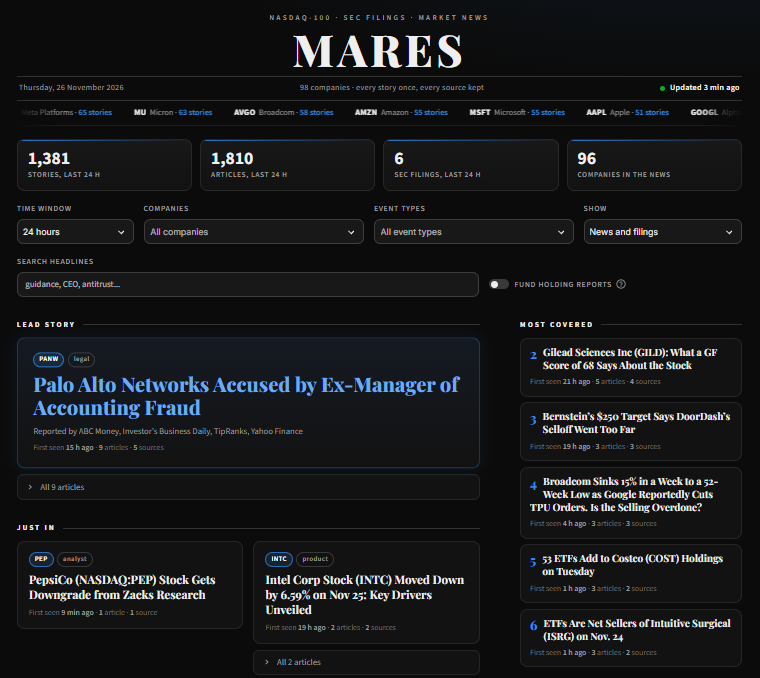
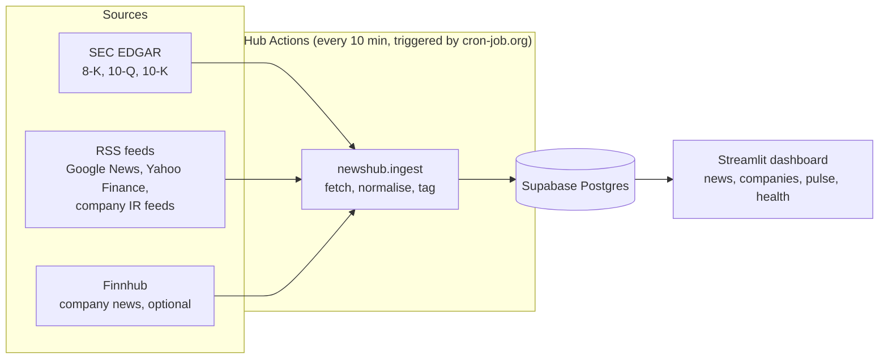

# MARES

**A live news desk for the Nasdaq-100.** SEC filings and market news for 98 companies, collected every
10 minutes, with duplicate stories grouped by AI so each story appears once with every source kept.

**Live app: [mares-news.streamlit.app](https://mares-news.streamlit.app)**

[](https://github.com/BillJ30/MARES/actions/workflows/tests.yml)
[](https://github.com/BillJ30/MARES/actions/workflows/ingest.yml)



## Highlights

- **Primary sources first.** SEC EDGAR filings (8-K, 10-Q, 10-K and foreign-issuer forms) for 98 Nasdaq-100
  companies, plus Google News, Yahoo Finance and optional Finnhub headlines.
- **Every 10 minutes, unattended.** GitHub Actions runs the collector; cron-job.org triggers it through the
  GitHub REST API because GitHub's own scheduler proved unreliable for new repositories.
- **Duplicate stories grouped with embeddings.** Headlines are embedded with `all-MiniLM-L6-v2` and compared
  in pgvector; in an early run 300 of 804 new headlines (37%) joined an existing story instead of repeating it.
- **Readable 8-K filings.** Item codes become plain titles and tags, e.g. item 5.02 is
  "Departure or Appointment of Directors or Officers", tagged `leadership`.
- **Fast on free infrastructure.** Batching database round trips cut a full run from 5m 24s to about 1 minute.
- **Safe by design.** The public dashboard logs in as a read-only database user; row level security blocks
  everything else; secrets live in GitHub and Streamlit, never in the code.
- **Tested.** 35 automated tests, including end-to-end runs against Postgres with pgvector, on every push.
- **Costs nothing to run.** GitHub Actions, Supabase, Streamlit Community Cloud and cron-job.org free tiers.

> Not financial advice. MARES collects and organises public information and links to the original publishers.

## How it works



Each run:

1. Looks up each company's SEC number (CIK) once and caches it in the database.
2. Pulls recent filings from EDGAR and turns 8-K item codes into readable titles and tags
   (for example item 5.02 becomes "Departure or Appointment of Directors or Officers", tagged `leadership`).
3. Reads the RSS feeds and, if a key is set, Finnhub company news. News feeds rotate through the
   watchlist in batches (50 companies per run), so every company gets fresh news about every
   20 minutes while SEC filings for every company are checked every 10 minutes.
   This keeps each run short and stays polite to the free feeds.
4. Normalises URLs (drops tracking parameters) and inserts only rows it has not seen before.
5. **Groups duplicate stories.** Each headline is turned into an embedding (384 numbers that capture
   its meaning) with the open-source `all-MiniLM-L6-v2` model, run locally through fastembed: no API, no cost.
   pgvector then finds the most similar earlier headline about the same company within 48 hours; if the
   similarity is at least 0.78, the new item joins that story. Nine outlets reporting the same Nvidia news
   become one story with nine sources.
6. Tags news headlines with event types (earnings, guidance, leadership, m-and-a, legal, analyst,
   restructuring, capital-return, product) using transparent keyword rules, matching the tags SEC filings get.
   Automated fund-holding reports ("Fund X acquires 1,000 shares of Nvidia") are tagged `holdings` and hidden
   from the dashboard by default, so they do not crowd out real news.
7. Deletes rows older than the retention window so the free database never fills up.
8. Writes a row to `ingest_runs` with counts and any errors, so failures are visible.

If one source or one company fails, the run logs it and carries on with the rest.

## Dashboard

A Streamlit app (`dashboard/`) reads the database and has four pages:

| Page | What it shows |
| --- | --- |
| **Latest news** | One card per story with every source behind it, filterable by company, event type, time window and text search |
| **Company** | Stories per day for one company, its latest stories and its SEC filings |
| **Market pulse** | Most covered companies, the mix of event types per day, the share of duplicate coverage, and recent filings such as leadership changes |
| **Pipeline health** | Every collector run: status, run time, items saved, problems |

Run it locally:

```bash
pip install -r dashboard/requirements.txt
streamlit run dashboard/app.py
```

The public version logs in as a **read-only database user** (`db/dashboard_role.sql`), so the app can never change data.
It has a dark, newspaper-style theme. Charts use a colour-blind-safe palette (validated for the dark background) with a fixed colour per event type, and every chart has a table view.

## Data sources

| Source | Cost | Key needed | What it gives |
| --- | --- | --- | --- |
| [SEC EDGAR](https://www.sec.gov/search-filings/edgar-application-programming-interfaces) | Free | No (name and email in User-Agent) | Official filings: earnings, leadership changes, deals, annual and quarterly reports |
| Google News RSS | Free | No | Headlines from many publishers, per company |
| Yahoo Finance RSS | Free | No | Company headlines |
| [Finnhub](https://finnhub.io) | Free tier | Yes, optional | Company news (free tier is for personal use) |

Only headlines, short summaries and links are stored. Full articles are never copied, so readers always go to the original publisher.

## Setup (about 15 minutes)

### 1. Create the database

1. Sign up at [supabase.com](https://supabase.com) and create a new project (free plan).
2. Click **Connect** at the top of the project and copy the **Session pooler** connection string.
   Use the pooler string, not the direct one: the direct connection is IPv6 only and GitHub's runners cannot reach it.
3. Replace `[YOUR-PASSWORD]` in the string with your database password.

You do not need to create any tables. The job applies `db/schema.sql` on every run.

### 2. Push the code to GitHub

```bash
git init
git add .
git commit -m "Ingestion pipeline: EDGAR, RSS and Finnhub into Postgres"
git branch -M main
git remote add origin https://github.com/<your-username>/MARES.git
git push -u origin main
```

Make the repository **public** so GitHub Actions minutes are free.

### 3. Add the secrets

In the repository go to **Settings > Secrets and variables > Actions > New repository secret** and add:

| Name | Value |
| --- | --- |
| `DATABASE_URL` | the Session pooler string from step 1 |
| `SEC_USER_AGENT` | your name and email, e.g. `Jane Doe jane@example.com` |
| `FINNHUB_API_KEY` | optional, from finnhub.io |

### 4. Run it

Go to the **Actions** tab, pick **Ingest news** and click **Run workflow**.
After a minute, open the Supabase **Table Editor** and look at `news_items` and `ingest_runs`.
GitHub's own schedule is a backup only: it is often delayed or skipped on new repositories.

### 5. Trigger it every 10 minutes (cron-job.org)

1. Create a fine-grained GitHub token limited to this repository with **Actions: Read and write** only.
2. On [cron-job.org](https://cron-job.org), create a job that runs every 10 minutes:
   - URL: `https://api.github.com/repos/<your-username>/MARES/actions/workflows/ingest.yml/dispatches`
   - Method: `POST`, body: `{"ref":"main"}`
   - Headers: `Accept: application/vnd.github+json`, `Authorization: Bearer <token>`, `X-GitHub-Api-Version: 2022-11-28`
3. A test run should return **204 No Content** and start a run on the Actions tab.

## Running locally

```bash
python -m venv .venv
source .venv/bin/activate          # Windows: .venv\Scripts\activate
pip install -r requirements.txt
cp .env.example .env               # then fill in your values

python -m newshub.ingest --dry-run           # fetch and print, no database needed
python -m newshub.ingest                     # fetch and store
python -m newshub.ingest --sources edgar -v  # one source, with logging
```

## Changing the watchlist

The default list is the Nasdaq-100. The index is reshuffled every December, so review the list once a year.
`news_batch_size` in the same file controls the news rotation (`0` = every company on every run), and
`python -m newshub.ingest --all-news` forces a full news refresh once.

Edit `config/watchlist.yaml`. Each company needs a ticker and a display name; everything else is optional:

```yaml
companies:
  - ticker: NVDA
    name: Nvidia
    news_query: "Nvidia OR NVDA"            # custom Google News search
    feeds: ["https://example.com/ir/rss"]   # extra feeds, e.g. investor relations
```

## Database

| Table | Contents |
| --- | --- |
| `companies` | ticker, display name, SEC CIK |
| `news_items` | one row per headline or filing per company: title, link, source, time (UTC), SEC form and items, tags |
| `ingest_runs` | one row per run: status (`ok`, `partial`, `failed`), counts per source, errors |
| `story_clusters` (view) | one row per story: headline, first and last seen, number of articles and sources |

`news_items` also holds each headline's `embedding` (pgvector, 384 dimensions) and its `cluster_id`
(the id of the first report of that story).

### Tuning the duplicate grouping

The similarity threshold is a judgement call: too low merges different stories, too high leaves duplicates apart.
Look at the groups, then try another value on the last few days without re-running the model:

```bash
python -m newshub.cluster --recluster-days 3 --threshold 0.82
```

and set the value you prefer as `cluster_threshold` in `config/watchlist.yaml`.

Row level security is switched on with no policies, which blocks Supabase's public REST API.
The job and the dashboard connect directly as the table owner and are not affected.

## Tests

```bash
pytest -q                                                      # parser and pipeline tests
TEST_DATABASE_URL=postgresql://... pytest -q                   # plus end-to-end tests on a real Postgres
```

The **Tests** workflow runs the full suite, including a Postgres 16 service with pgvector, on every push.

## Things to know about the free tiers

- GitHub's built-in schedule is best effort and was found to skip most runs on a new repository, which is why
  cron-job.org triggers the workflow instead. The token it uses can only start workflows in this repository.
- GitHub pauses scheduled workflows in public repos after 60 days with no commits. A small commit restarts them.
- Supabase pauses free projects after a week without activity. The 10-minute job keeps it active.
- The SEC allows up to 10 requests a second. The job stays well under that.

## Roadmap

- [x] Step 1: ingestion from EDGAR, RSS and Finnhub into Postgres on a schedule
- [x] Step 2: group duplicate stories across sources (sentence embeddings + pgvector) and tag event types
- [x] Step 3: Streamlit dashboard: latest stories, company pages, market pulse, pipeline health
- [ ] Step 4: short summaries, tone labels (FinBERT) and Telegram alerts for important filings
- [ ] Step 5: public launch

## License

MIT
